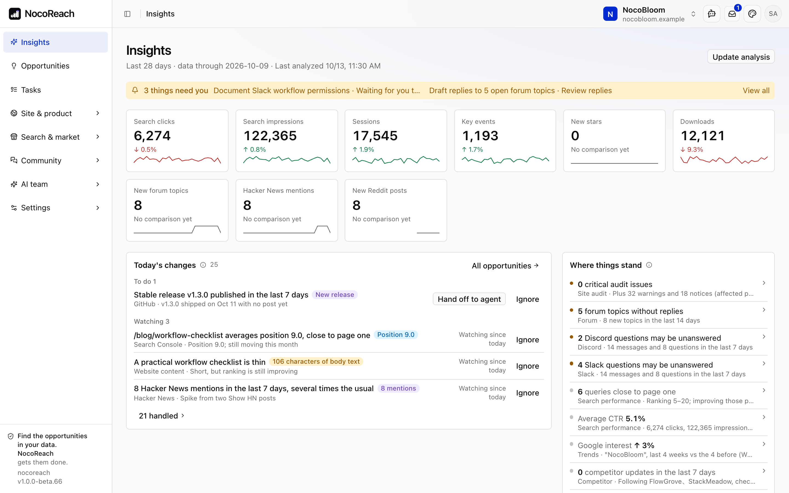
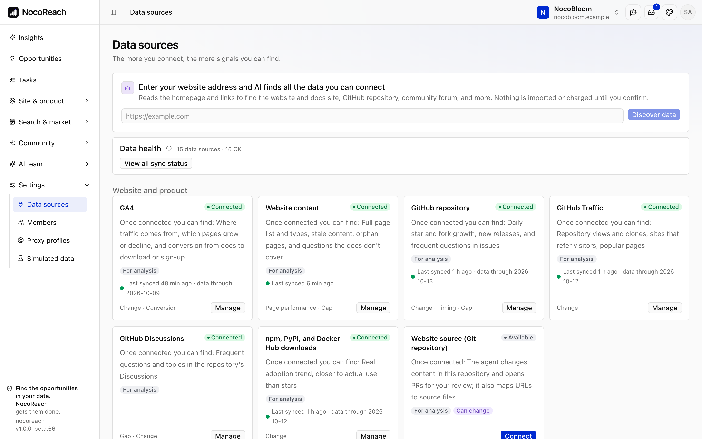
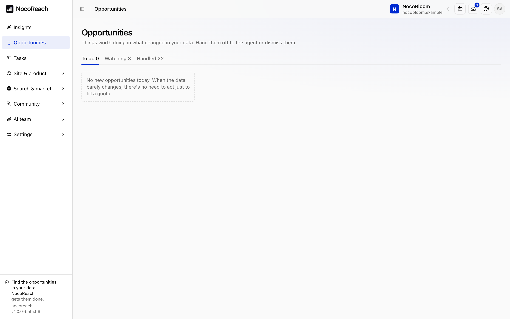
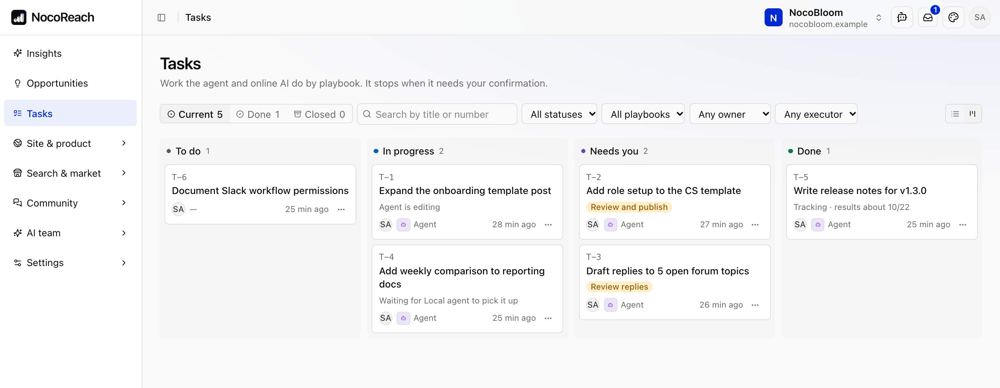
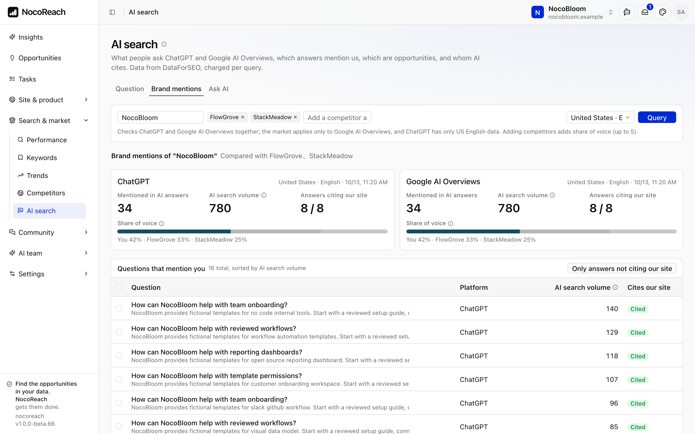

<p align="center">
  
</p>

<h1 align="center">NocoReach</h1>

<p align="center"><strong>データを読み解き、市場の機会に変え、実行まで進めます。</strong></p>

<p align="center">
AI グロース運用プラットフォーム。<br>
データ収集、毎日の分析、エージェントによる実行を、ひとつのプラットフォームで。
</p>

<p align="center">
  <a href="README.md">English</a> · <a href="README.zh-CN.md">简体中文</a> · <strong>日本語</strong>
</p>

> **プロジェクトの状況**：NocoReach は初期段階にあり、機能と画面は引き続き変わります。Issue や Pull Request を歓迎します。



## データは多いのに、行動につながらない

**データが分散している。** 検索データは Search Console や SEO ツールに、アクセスデータは GA4 に、ユーザーの声はフォーラム、SNS、コミュニティのチャットに散らばっています。オープンソース製品なら、GitHub のスター数やパッケージのダウンロード数もあります。全体を把握するには、十数個の画面を行き来する必要があります。

**データがあっても、次に何をすべきか分からない。** Ahrefs や Semrush などの SEO プラットフォームはデータが充実しており、レポートと指標として提供します。次に何をするか、何から始めるかは自分で判断する必要があり、実行も別に手配しなければなりません。

**データと実行がつながっていない。** OpenSEO などのオープンソースツールは、必要な分だけ低コストで同じデータを取得でき、MCP を通じて Claude Code などのエージェントに渡すこともできます。ただし対象は SEO と AI 検索のデータに限られ、実行は各自のローカル環境で行われます。エージェントはその時に渡された情報しか見られず、何を行い、どんな結果になったかの共通の記録も残りません。

## NocoReach：データから実行まで、ひとつのプラットフォームで

NocoReach は、グロース運用の一連の流れをひとつのプラットフォームにまとめます。

```
データソース → 毎日の分析 → 機会 → タスク → エージェントの実行 → レビューと公開 → 効果の追跡
```

- **データを一か所に集約。** 20 以上のデータソースに対応し、今後も増えていきます。検索、Web サイト、GitHub、パッケージのダウンロード数、コミュニティ、AI 検索のデータを同じデータベースに保存し、まとめて分析します。NocoReach はオープンソースなので、必要なデータソースがなければ、エージェントに開発させることができます。
- **分析が結論まで出す。** 毎日、ルールで変化を抽出し、対応する価値があるかを AI が判断して、根拠を添えます。
- **エージェントが全体の文脈を把握。** タスクの実行時、エージェントは関連する指標、キーワード、ページ、監査結果、コミュニティの投稿、プロジェクトナレッジを直接読み込みます。人が改めてまとめる必要はありません。
- **実行はリポジトリへ。** エージェントが Web サイトやドキュメントのリポジトリでファイルを編集し、Pull Request を作成します。レビューとマージはあなたが行います。
- **結果を追跡できる。** 公開から 7 日後と 28 日後にデータを自動で比較します。各タスクには、根拠から実行、結果までの記録がすべて残ります。

|                | Ahrefs などの SEO プラットフォーム | OpenSEO などのオープンソースツール               | **NocoReach**                                                                                                  |
| -------------- | ---------------------------------- | ------------------------------------------------ | -------------------------------------------------------------------------------------------------------------- |
| データの範囲   | SEO と AI 検索                     | SEO と AI 検索                                   | SEO、AI 検索、Web サイト、GitHub、コミュニティなど 20 以上のデータソース<br>その他の市場データも自分で接続可能 |
| 次に何をするか | レポートを見て自分で判断           | 自分で判断、またはローカルのエージェントに任せる | 毎日の分析が根拠付きで機会を提案                                                                               |
| 実行           | プラットフォームの外で行う         | 各自のローカルのエージェントで行う               | プラットフォーム上でエージェントがリポジトリを編集し、PR を作成                                                |
| レビューと効果 | 自分で手配                         | 自分で手配                                       | 人がレビューしてから公開、7 日後と 28 日後に自動比較                                                           |
| 導入形態       | SaaS                               | セルフホスト                                     | セルフホスト、全ソースコード公開                                                                               |

## 主な機能

### データソース

| Web サイトと製品                                                                                                                                                   | 検索と市場                                                                                                                                | コミュニティ                                                                                  |
| ------------------------------------------------------------------------------------------------------------------------------------------------------------------ | ----------------------------------------------------------------------------------------------------------------------------------------- | --------------------------------------------------------------------------------------------- |
| GA4 のアクセスとコンバージョン<br>Web サイトのページとサイト監査<br>GitHub のスター、フォーク、トラフィック、Discussions<br>npm、PyPI、Docker Hub のダウンロード数 | Google Search Console<br>キーワード調査と順位トラッキング<br>Google Trends<br>競合の動向と概要<br>AI 検索（ChatGPT、Google AI Overviews） | Discourse フォーラム<br>Hacker News、Reddit、X<br>Discord、Slack<br>YouTube、Bilibili、小紅書 |

- **自動検出。** Web サイトのアドレスを入力すると、接続できるドキュメントサイト、GitHub リポジトリ、コミュニティフォーラムを AI が見つけます。確認するまで接続はされません。
- **接続ガイド。** データソースごとに、準備するもの、よくある質問、接続後に分かることを説明します。
- **データの健全性。** 同期に失敗したデータソースや古くなったデータを一覧で表示します。



### 毎日の分析と機会

- 34 個の分析ルールを内蔵し、データを 5 種類のシグナル（変化、ギャップ、タイミング、ページのパフォーマンス、コンバージョン）にまとめます。
- 分析は毎日決まった時刻に実行されます。変化ごとに AI の判断（対応する、まず様子を見る、対応不要）と、その理由・根拠が付きます。
- 「まず様子を見る」とした変化には、見る指標、判断の条件、期限を必ず記載し、期限が来たら結論を出します。
- 新しい発見がない日は、提案を作りません。
- ルールはオン・オフや閾値の調整ができ、チームが重視する点を書き加えることもできます。



### タスクとエージェントの実行

すべての機会には、データ、期間、関連ページといった根拠が付いています。対応する価値があればタスクにし、なければ無視します。

タスクはプレイブックに沿って進みます。NocoReach には 12 個のプレイブックが組み込まれています。

| 種類     | プレイブック                                                                                                           |
| -------- | ---------------------------------------------------------------------------------------------------------------------- |
| 改善     | 既存ページの改善、多言語版の同期                                                                                       |
| 新規作成 | ドキュメントページの新規作成、ブログ記事の執筆、リリースノートの執筆、コンテンツのテーマと構成、コミュニティへの返信案 |
| 調査     | キーワード調査、変化の原因調査、競合比較、コミュニティの質問のまとめ                                                   |
| 技術     | 技術的な修正（リンク切れ、リダイレクト、サイトマップ、構造化データ）                                                   |

- **オンライン AI** は調査、方針、下書きを担当します。
- **リポジトリの変更はエージェントが行います。** あなたのパソコンやサーバー上の Runner を通じて Claude Code などのコーディングツールを使い、リポジトリを読み、ファイルを編集し、チェックを実行して Pull Request を作成します。1 つのタスクにつき、ブランチと Pull Request が 1 つずつです。
- エージェントが変更できるのは、許可したディレクトリだけです。使用したモデル、呼び出したツール、拒否された操作は、すべてタスクページに記録されます。



### レビュー、公開、効果の追跡

- 重要な段階は人が確認します。実行前にタスクの説明を確認し、方針ができたらレビューし、公開前に変更内容をチェックします。
- Pull Request はあなたがレビューしてマージします。コミュニティへの返信はエージェントが下書きし、投稿はあなたが行います。NocoReach が自動で投稿することはありません。
- 公開後、変更したページの検索クリック数とページビューを公開前と比較し、7 日後と 28 日後に結論を出します。結論は「上昇」「下降」「明確な変化なし」「データ不足」のいずれかです。データの動きだけを示し、因果関係は推定しません。
- チームで使えます。管理者とメンバーの 2 つの役割があり、タスクごとに担当者を決め、対応が必要なことはアプリ内通知で知らせます。

### AI 検索での見え方

ChatGPT と Google AI Overviews が関連する質問に答えるとき、あなたの製品に言及しているか、どのページを引用しているか、競合と比べて言及のシェアはどうかを確認できます。競合には言及していて、あなたには言及していない質問が、まず埋めるべきコンテンツのギャップです。



### プレイブック、スキル、プロジェクトナレッジ

- **プレイブック**：タスクの種類ごとの手順と、人のレビューが必要な段階を定義します。編集も新規作成もできます。
- **スキル**：標準的な SKILL.md 形式で、Claude Code などのツールでもそのまま使えます。GitHub のリンクからインポートできます。
- **プロジェクトナレッジ**：ブランド、ポジショニング、トーン、用語、執筆ルールをまとめ、タスクごとにエージェントへ渡します。

## こんな方に

- AI にマーケティングの仕事へより深く関わってほしいすべての方
- Web サイト、ドキュメント、ブログを Git リポジトリ（Markdown、MDX）で管理しているチーム。エージェントが直接編集して Pull Request を作成できます。
- オープンソースプロジェクトや開発者向け製品。GitHub、パッケージのダウンロード数、技術コミュニティのデータをまとめて分析できます。

## セキュリティと管理

- **セルフホスト**：自分のサーバーで運用し、データは接続したサービスとの間でのみやり取りされます。
- **シークレットの暗号化**：認証情報はサーバー側で暗号化して保存します。
- **モデルを選べる**：NocoReach で設定したモデルと API キーを使います。
- **コストの上限**：DataForSEO など従量課金のデータソースには月の予算を設定できます。
- **サーバー側での権限チェック**：すべての操作について、管理者とメンバーの権限をサーバー側で確認します。
- **ネットワークプロキシ**：データ収集に HTTP、HTTPS、SOCKS5 のプロキシを使えます。
- 画面は英語と中国語に対応し、1 つのインスタンスで複数のプロジェクトを管理できます。

## はじめに

Node.js 24 と pnpm が必要です。

```bash
git clone https://github.com/nocobase/nocoreach.git
cd nocoreach
pnpm install
pnpm nocobase config init
pnpm dev
```

ターミナルに表示されたアドレスを開き、`config.yml` の初期管理者アカウントでサインインします（本番で使う前にパスワードを変更してください）。続いて：

1. プロジェクトを作成し、Web サイトのアドレスを入力します。
2. Settings → Data sources でデータソースを接続します。
3. AI team でモデルを設定し、Runner を接続して、デフォルトのエージェントを選びます。
4. Insights で毎日の分析結果を確認します。

実際のアカウントなしで試すには、[模擬データ](docs/MOCK-DATA.md)でデモ環境を起動できます。本番環境へのデプロイは[ビルドとデプロイ](docs/APP-TEMPLATE.md)を参照してください。

## NocoBase 3 がベース

NocoReach は [NocoBase 3](https://www.nocobase.com) のアプリケーションです。アカウント、権限、通知、定期実行、モデルとエージェントの管理は NocoBase が提供し、NocoReach はグロース運用そのものに専念しています。ソースコードはすべてこのリポジトリにあり、自分で変更することも、エージェントに変更させることもできます。

## ドキュメント

| ドキュメント                             | 内容                                                                   |
| ---------------------------------------- | ---------------------------------------------------------------------- |
| [開発ガイド](docs/DEVELOPMENT.md)        | コード構成と開発ルール（英語）                                         |
| [模擬データ](docs/MOCK-DATA.md)          | 実際のアカウントなしでデモ・テスト環境を起動（中国語、英語の概要あり） |
| [ビルドとデプロイ](docs/APP-TEMPLATE.md) | 設定、ビルド、Docker でのデプロイ（英語）                              |
| [変更履歴](CHANGELOG.md)                 | リリースごとの変更内容（英語）                                         |
