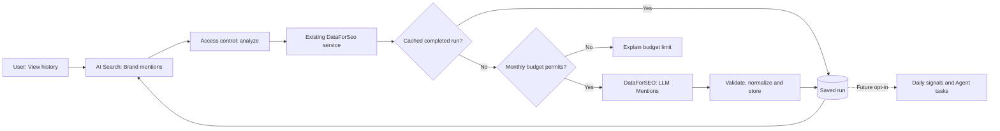

# DataForSEO capability inventory and growth opportunities

> Reviewed against NocoReach `main` and the OpenSEO integration on 2026-11-10.
> Scope: existing application behavior and real server code, not merely APIs advertised by the provider.
> This is a prioritization guide, not a promise to implement every available endpoint.

## Goal

Use additional DataForSEO data to find **evidence-backed, actionable growth opportunities** and hand them to a human or an agent. Do not turn NocoReach into a general-purpose API explorer or an unbounded paid crawler.

## Inventory

| DataForSEO area | Already in NocoReach | Opportunity / actual gap | Priority |
| --- | --- | --- | --- |
| DataForSEO Labs: keyword research | Related keywords, suggestions, ideas, keyword overview, SERP results, saved terms | Better clustering and cross-source evidence for content planning | P1: improve workflows |
| DataForSEO Labs: competitor history | **Implemented**: `historical_rank_overview/live` in `competitor-research.ts` | Use existing history more consistently in insights and opportunity evidence | P1: reuse; **do not add a duplicate client** |
| DataForSEO Labs: keyword gap | **Implemented**: `domain_intersection/live` with `intersections:false` in `competitor-research.ts`; also supported by the shared research adapter | Better ranking of gap opportunities, explain brand exclusions and coverage limits | P1: reuse |
| DataForSEO Labs: domain overview | Ranked keywords, relevant pages, traffic estimates | Discovery beyond the fixed first batch, optional granular gap workflows | P2 |
| Backlinks API | Link summary, linking pages/domains, pages, history and gap via `backlinks-service.ts` / research adapter | Turn link gaps into evidence-based outreach opportunities; avoid duplicating existing screens | P2 |
| Google SERP | Organic result research and rank tracking; top 100 desktop weekly | Optional mobile and user-selected frequency with explicit cost estimate | P2 |
| Google Trends / Keywords Data | Google Trends and Google Ads keyword ideas; keyword metrics | Detect emerging topics, connect Trends to the daily opportunity workflow | P1: reuse |
| AI Optimization: LLM Mentions | Brand mentions, cross-brand comparisons, questions, competitor mention gap, model answers | **Add historical gained/lost mentions, then decide if a recurring opportunity rule is justified** | **P0: first increment in this branch** |
| AI Optimization: mentions timeseries | No dedicated history UI prior to this branch | `timeseries_new_lost/live` on-demand by platform, monthly, with the existing budget/caching guard | P0: implemented in this branch |
| Content Analysis | No product-wide Content Analysis data source identified | Brand/topic mention discovery and sentiment signals, subject to corpus coverage verification | P1: research before building |
| Domain Analytics | No Technologies API integration identified | Technologies and adoption trends; useful for technographic lead research, not proof of purchase intent | P1: research before building |
| On-Page API | Site audit uses already-read site pages; Lighthouse is available | Full independent crawl and JS rendering only if existing site-content checks cannot suffice | P2 |
| Business Data / Google Maps | Not part of core NocoReach growth research | Local-business discovery/rank grid for local SEO users | P3 |
| Merchant / App Data | No core integration identified | Commerce and app-store research; not required for NocoReach's current software-growth focus | Defer |

**Correction to earlier assumptions:** historical competitor rankings and the domain keyword intersection are **already integrated**. The useful work is to exploit their results in the analysis-to-agent workflow, not to rebuild those API adapters.

## First increment: AI mention history

- UI: `AI Search > Brand mentions > AI mention gains and losses`
- API: `POST /v3/ai_optimization/llm_mentions/timeseries_new_lost/live`
- Granularity: `group_range: month`; at most the preceding 12 completed calendar months, no earlier than `2025-08-01`
- Platforms: ChatGPT (US English only) and Google AI Overviews (the selected market)
- Output: monthly new/lost mention counts; the service also retains new/lost AI search volume from the provider
- Payment: **only after a user clicks** `View history` for a platform. Cached responses are reused for 30 days. Explicit refreshing uses the existing duplicate-charge and uncertain-result guards
- Access: existing `analyze` capability; no read-only viewer can trigger the paid action
- UI: historical provider estimates, **not** website traffic or total brand mentions
- Demo/test: deterministic synthetic responses; do not use these to claim the live DataForSEO endpoint was validated

Source: [DataForSEO LLM Mentions new/lost endpoint](https://docs.dataforseo.com/v3/ai_optimization-llm_mentions-timeseries_new_lost-live/).

## Execution architecture

Do not automatically run paid historical queries whenever the user opens the page. Any future recurring task must be explicitly configurable and budget-aware.

## Next iterations

1. **P1: Exploit existing competitor history and keyword intersection.** Audit the opportunities/rules that already consume these data. Add only the missing detection and hand-off logic, include market, observation date, DataForSEO estimate versus first-party measurement, and source link in task evidence.
2. **P1: Evaluate Content Analysis and Technologies.** Test real coverage and freshness on a handful of software-sector competitors and confirm exact API cost and terms before adding screens or schedules. Brand mentions from Content Analysis must not be described as exhaustive Reddit/X/Xiaohongshu listening.
3. **P1: Convert AI mention losses into actionable opportunities.** Only after the history has enough reliable observations and a user-selected schedule; include what changed and the confidence limits, rather than implying causality.
4. **P2: Better rank tracking.** Make frequency and mobile visibility opt-in with a pre-run cost preview; keep low-cost weekly desktop as default.
5. **P2/P3: Broader SEO, local, commerce and app-store research** only when a demonstrable customer workflow requires the data.

## Acceptance and verification

- Query is **not** fired on page load.
- The selected Google market is honored; ChatGPT uses US English.
- The same query gets a saved result within the reusable window; uncertain and budget-exceeded queries do not silently retry.
- Invalid/malformed responses do not masquerade as successful measurements; empty history is visibly different from an error.
- No new datasource credentials or independent billing table is needed.
- Mock and demo environments return deterministic non-real data.
- The full application's lint/typecheck/tests and browser end-to-end run must pass before merging.
- Confirm provider request body, response shape and actual USD cost once in a controlled live connection before release.

## Sources and boundaries

- [NocoReach competitor research](../server/nocoreach/competitor-research.ts)
- [NocoReach shared DataForSEO budget and cache](../server/nocoreach/dataforseo.ts)
- [DataForSEO API reference](https://docs.dataforseo.com/v3/)
- [LLM Mentions time series](https://docs.dataforseo.com/v3/ai_optimization-llm_mentions-timeseries_new_lost-live/)
