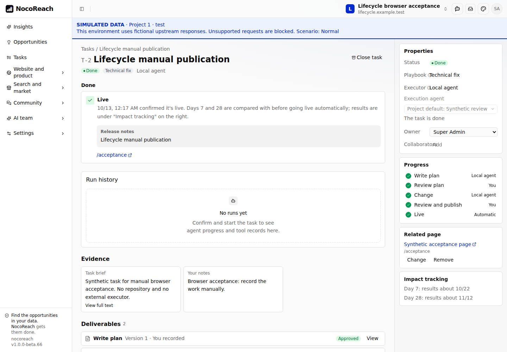
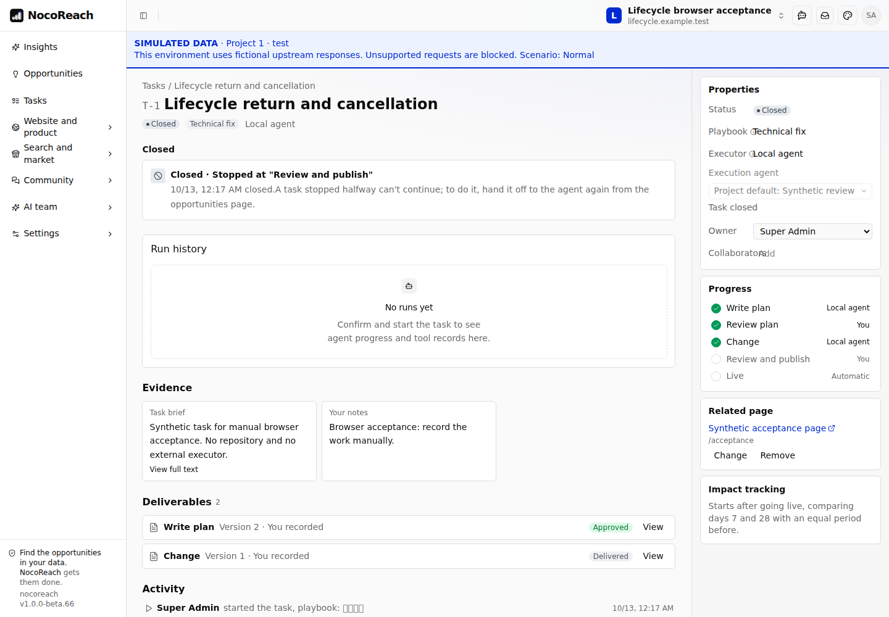

# Persistent business lifecycles

This refactor uses the `@nocobase/lifecycle` library already installed with template beta.67. It keeps the official Agents, Jobs, and Scheduler plugins, and removes the application’s retired Workflow compatibility implementation. There is no dependency or template-version upgrade.

## Responsibilities and storage

| Component                | Responsibility                                                                           | Durable records                                                                          |
| ------------------------ | ---------------------------------------------------------------------------------------- | ---------------------------------------------------------------------------------------- |
| Task lifecycle           | Declared execution transitions, optimistic version checks, transition history            | Execution fields on `nrTasks`, `nrLifecycleTransitions`                                  |
| Task run store           | Current business run, immutable accepted input, official run mapping, due reconciliation | `nrTaskRuns`                                                                             |
| Official Agents          | Agent eligibility, Runner claims, model calls, run credentials, transcript, cancellation | Existing Agents collections                                                              |
| Daily analysis lifecycle | Project/day deduplication, attempt ownership, retry deadlines, uncertain outcomes        | `nrAnalysisRuns`                                                                         |
| Official Scheduler       | Schedule configuration, occurrence delivery, execution reporting                         | Existing Scheduler collections; `nrAnalysisOccurrences` holds business delivery receipts |
| Observation lifecycle    | Independent day 7/day 28 checks, data readiness, one committed result per checkpoint     | `nrTaskObservations`                                                                     |
| Lifecycle Jobs adapter   | Dispatch after commit and recover pending/expired effects                                | `nrLifecycleEffectRuns`; the queue is a delivery mechanism                               |
| Existing snapshots       | Frozen playbooks/flows, artifacts, reviews, request fingerprints, legacy archives        | Existing `nrSnapshots` and `nrTasks.evidence.work`                                       |

`server/providers/nocoreach.ts` assembles one application-owned runtime. All definitions are registered before recovery starts. Shutdown stops its dispatcher together with the existing business timers. Daily recovery and observation recovery run independently, so an error in one domain does not prevent the other from being attempted.

The installed Lifecycle beta.1 store schema is included in the new migration, including effect continuations and lease fields. The implementation uses the official Repository store and Jobs adapter rather than a copied runtime or an application-managed generic workflow engine.

## Task execution

New idle tasks begin with `executionEngine = lifecycle-v1`, `executionState = idle`, and `lifecycleVersion = 0`. A pre-existing idle task is adopted when the user explicitly starts it. Already started legacy flows retain their engine and frozen execution context.

The task states are `idle`, `ready`, `queued`, `running`, `review`, `merging`, `verifying`, `release`, `completed`, and `cancelled`. Completion and cancellation are final execution states. Moving a completed card on the board remains a planning operation; it does not reopen execution.

| Business action                                            | Declared transition                                  |
| ---------------------------------------------------------- | ---------------------------------------------------- |
| Start task                                                 | `start`                                              |
| Approve a stage or return it for changes                   | `approve`, `requestChanges`                          |
| Record manual work or retry a stage                        | `recordManual`, `retry`                              |
| Agent claim and accepted result                            | `claim`, `result`                                    |
| Retry a failed merge or accept its result                  | `retryRelease`, `mergeResult`                        |
| Record a manual merge, wait longer, or confirm publication | `markMerged`, `waitLonger`, `confirmLive`, `publish` |
| Automatic live verification                                | `live`, `releaseFailed`                              |
| Cancel an unfinished task                                  | `cancel`                                             |

The business command retains the existing owner/member checks, artifact identity, reviewed PR head, frozen flow, revision, and request fingerprint. Within one database transaction it prepares related business writes and official Agent enqueueing, fires the native transition with the expected lifecycle version, then saves the compatible Work projection and request receipt. A rejected transition rolls back the complete transaction. Official Agent events are emitted after commit.

Lifecycle request replay alone does not compare the input body. NocoReach therefore still checks the existing hash of the command and actor before calling `fire()`: an exact retry is accepted once, and a changed payload with the same request ID is rejected. Comments, saved drafts, board moves, ownership changes, and observation results that leave execution unchanged do not re-enter a state or increment its lifecycle version. Classic plan/step execution commands are rejected for a task already using the native engine.

The Work projection remains the existing client contract and retains the frozen playbook/flow and business history. The additional `lifecycle` object on task reads exposes the native name, engine, state, and version; it is `null` for legacy execution. No new workflow editor or alternative task UI is introduced.

New analysis and import interruption messages are persisted as semantic keys and translated when displayed. The historical translation map remains unchanged. Trusted system errors follow the selected interface language, while unrecognized external error text remains intact.

### Agent and release recovery

`nrTaskRuns` is the current run store. Reads prefer it over the old archived run snapshots. Writes cannot reassign an existing run to another task/project and require a matching task. The run input, capability snapshot, material references, and official `pluginRunId` remain part of the accepted business record.

The periodic reconciler reads at most 50 due records using `(nextSyncAt, id)`. It reserves the next poll before doing I/O. A stale poll cannot requeue a run whose terminal write already cleared `nextSyncAt`. Official callbacks still go through TaskService’s contextual acceptance checks; duplicate results do not create a second artifact or transition. Legacy online requests keep their existing bounded execution and uncertain-result behavior.

Release verification reads at most 50 due tasks using `(nextCheckAt, id)`. Page fetching remains outside the transaction and uses the project’s network context. Before committing a live check, the service re-reads the release under the task lock and compares it with the fetched candidate. Cancelled or changed releases cannot receive the stale result.

The generic official Agent retry guard is retained. Retrying a `nocoreachTask` through a generic Agent endpoint would bypass the business stage, review, and new-input checks; task retry continues through the task page/API.

## Daily analysis

The schedule key remains `nocoreach.daily-analysis`, with target type `app.nocoreach.daily-analysis`. It directly enqueues durable per-project analysis work and reports the final aggregate result to Scheduler. `legacy/schedule.ts`, its fake workflow tables/instruction registry, and `analysisCron` are removed.

An occurrence has one durable receipt. Scheduled analysis has a unique project/day key, and a project has at most one active attempt. Manual starts do not enable automatic retries. Retryable scheduled failures retain the 5/15/60 minute policy, persist the next deadline, and expire with their original business day. A disabled schedule suppresses automatic retries and catch-up. Existing schedule settings are read through a narrow Repository projection because the installed public Scheduler service does not expose a definition-read method.

Business-day deduplication retains the server’s local calendar for compatibility. Catch-up uses that local schedule only when the configured Scheduler timezone matches the server timezone. A schedule moved to another timezone is delivered by Scheduler; the application does not guess that zone’s due time or trigger an early model call.

### Uncertain external cost

Each analysis effect claims its attempt durably. Immediately before the first model request it records `requestStartedAt`. Output writes and settlement verify the same effect token, attempt, active lease, and mock configuration within the transaction.

The effect timeout is shorter than the shared 15 minute lease. Automatic generic effect retry is disabled for model submission. If execution is interrupted before a request is sent, the scheduled business retry policy may resume it. If a request may have been sent but no result was committed, recovery records `unknown` and requires the user to check the external result before explicitly starting another attempt. A forced retry of an expired effect cannot create a second model request; even if that fenced no-op is acknowledged successfully, recovery resolves the still-running business record as interrupted.

These guards also cover an application restart, an empty in-memory queue, a late response, and a mock setting change during output persistence. Persisted legacy analysis history remains readable; old uncertain executions are not blindly replayed.

## Day 7 and day 28 observations

Publishing creates the two observation records in the same transaction as the task’s live state. The unique `(taskId, day)` constraint and lifecycle version prevent two sweepers from committing the same result. Completed checkpoints remain separate from task execution and do not re-enter a completed task.

The worker waits until every configured Google source has reached the observation window. A source with no partitions is also unavailable; another source’s newer data must not conceal that absence. Calculations keep the existing page normalization, baseline windows, result fields, and same-project notes about concurrent changes.

Data retrieval occurs before the short result transaction. Completion re-reads the task and publication, then commits the result, compatibility history entry, and observation transition together. A changed/cancelled publication or competing result is handled as a conflict. A failing project is durably deferred and reported after the rest of the bounded batch has been attempted, so one bad record cannot indefinitely starve other projects. Results stay ordered by checkpoint day.

## Upgrade and import boundaries

The migration adds new tables and nullable task execution fields. It does not edit an executed migration, rewrite historical evidence, or enter an old task’s state.

On startup, a resumable backfill copies old task-run snapshots into the native run store and schedules only missing observations. Its cursor is a validated decimal string; identifiers beyond JavaScript’s safe integer range remain exact. Each page is idempotent and preserves a newer native run. Historical run snapshots without a matching task remain in their original archive and are reported as skipped. Backfill also creates due-time projections for existing releases without re-enqueueing their Agent runs.

Classic import is a separate, explicit migration operation. The initial replacement reset clears business tables and their current runtime records in one transaction. Data transfer still uses the existing multi-request import protocol; perform it while other writers are quiesced. The finish step resets the checkpoint and rebuilds the run/observation indexes. External execution references belonging to the source application are retained as provenance, while unresolved source runs are stopped for manual reconciliation. Source results and approvals remain readable. Scheduler occurrence receipts remain historical delivery records so an old delivery cannot be treated as a new request after replacement.

For deployment, retain a coordinated backup of the database, file storage, configuration, and encryption keys. Stop the previous application before starting the new build. Run the pending migration and allow the resumable backfill to finish before serving requests. A source-code downgrade after new native runs have been written is not a data rollback: the older version reads the old snapshot store. Restore the coordinated pre-upgrade backup when rolling back an installation; do not drop the new runtime tables while active work exists.

### Operational limit

The application still uses its existing in-process keyed locks for multi-record business commands. Database CAS and durable Jobs recovery do not make the entire application safe for concurrent writes from multiple application instances. This PR is verified on a single application instance with SQLite. Redis/other queue backends, PostgreSQL deployment, and full multi-instance business writes require their own validation and transaction-lock design.

## Validation

The verification uses real SQLite databases and the installed public Lifecycle, Jobs, Scheduler, and Agents APIs. Synthetic Runner reports replace only the external coding tool; model responses in mock tests use the existing dedicated mock integration boundary.

Coverage includes transaction rollback and lock release, restart with an empty queue, exact large IDs, stale task adoption, native transition rejection, HTTP request replay, duplicate Agent callbacks, immutable materials and reviewed artifacts, cancellation, run scope, due-queue fairness, scheduled/manual retry rules, uncertain request cost, mock configuration changes, legacy backfill, classic import, and observation atomicity.

The browser suite is `tests/playwright/task-lifecycle.test.ts`. It is opt-in and uses two fresh tasks, an accessible synthetic offline Runner Agent, no repository, and no model credentials in a dedicated mock deployment. Task mutations are real browser clicks; tests inspect the resulting requests/responses rather than advancing stages directly through an API.

1. Sign in, start a technical fix, record a plan manually, return it for changes, submit version 2, approve, record the change, and cancel. Refresh and verify the persisted cancellation and deliverables.
2. Start another technical fix, record/review both stages, publish manually, and confirm it is live. Verify the completed lifecycle and pending day 7/day 28 observations.
3. Stop and restart the built application with the same database and storage, clear the session, sign in again in the same Chromium instance, and verify both tasks, artifacts, histories, and lifecycle versions.

Health must return 200 with `ok = true` before and after restart; unauthenticated OpenAPI must return 401. Browser console exceptions, page errors, and failed business API responses are collected separately from credentials.

The screenshots below show the persisted task pages after restarting the test application. These are synthetic business records, not a live repository change or a paid model run.

Build, test totals, and the final review result are recorded in the pull request description. Browser evidence is regenerated against the final build before the PR is opened.
