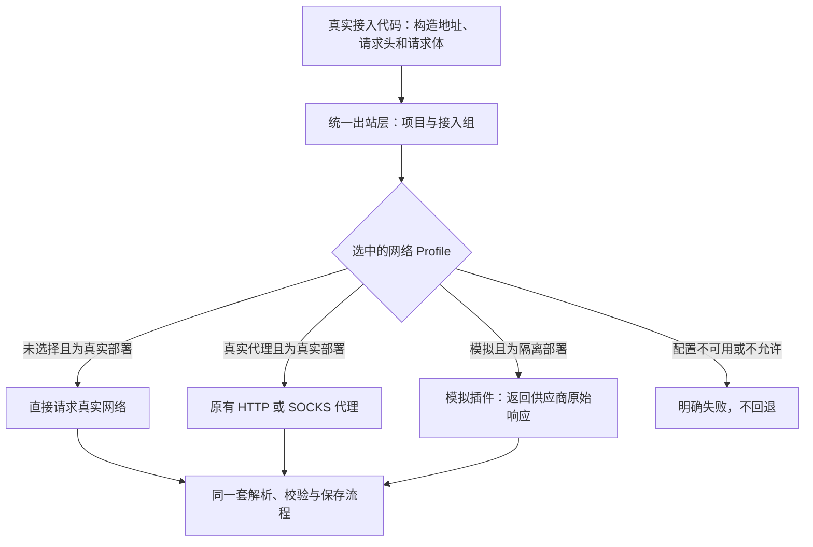

# 网络 Profile 与模拟数据

网络 Profile 复用现有的 `nrProxyProfiles` 接口和加密保存的配置。旧代理的 ID、地址、凭据、修订号校验、管理员权限及引用保护保持兼容。真实代理仍使用 HTTP/HTTPS/SOCKS；新增的“模拟响应”类型由模拟插件在进程内返回供应商原始响应，不需要代理地址，不进行 TLS 拦截，也不会在模拟失败后访问真实站点。

## 使用方法

先按[部署隔离要求](MOCK-DATA.md#2-必须隔离的部署配置)，在**专用演示或测试环境**中启用 `nocoreachMock`。部署开关只允许模拟执行器运行并禁止真实数据采集，不再暗中覆盖用户选择的 Profile。

打开**设置 → 网络 Profile**（`/proxy-profiles`），创建“模拟响应”类型的 Profile，选择场景、随机种子和包含时区的固定时间。表单会提供默认值，无需填写代理地址或账号密码。已有 Profile 的类型不能修改；需要另一种类型时，应新建并重新选择。

在**数据接入**的网络设置中选择这个 Profile 并保存。“应用到全部数据接入”会一次性为当前项目的全部接入组选择同一个模拟 Profile。修改共享 Profile 后，所有引用它的接入都会在下一次操作时使用新配置；引用列表会显示影响范围。GA4 和 GSC 共用 `google`，GitHub 仓库、流量与 Discussions 共用 `github`，使用 DataForSEO 的功能共用 `dataforseo`。Bilibili 和小红书有各自的模拟选择。

在真实部署中，未选择 Profile 表示**直连**；在模拟部署中，未选择表示**暂停采集**。配置损坏、模拟规则缺失、模拟执行器不可用，或者在模拟环境中选择真实代理，都会明确失败，不会自动直连。暂停保留已有数据及各接入的只读历史时间信息，因此历史报表不会突然跳到服务器当前日期。暂停不取消正在运行的任务，取消请使用对应接入的任务操作。

模拟 Profile 的“测试连接”只验证保存的配置和模拟执行器是否可用，**不表示真实站点连通，也不表示所有接口都有模拟规则**。真实代理的连接测试仍会执行原来的 HEAD 请求并显示响应状态。

## 请求流程



真实请求保留原有的逐次代理解析、错误时机、公共地址校验、IP 固定、TLS 主机名、重定向限制、响应体大小限制、取消、认证和连接池回收。模拟网站下载会在真实 DNS 解析前进入模拟路径，不会为了虚构域名而放宽真实网络的地址安全规则。

Bilibili、小红书仍在采集器协议边界接收模拟响应，YouTube 仍在工具执行和字幕读取边界接收模拟输出，随后使用原有解析器和结构校验。它们现在使用各自选中的网络 Profile，但**不会运行真实浏览器、OpenCLI 或 yt-dlp**。真实浏览器采集器桥接请求仍由部署管理，不经外部代理转发。这些测试不证明真实站点登录、反爬或提取器兼容性。

每次模拟操作固定 Profile ID、修订号、场景、种子、时间、项目和接入组。编辑或清除选择只影响之后的操作，不改变已经运行的任务。Google 后台任务保存不含凭据的快照，恢复时仍校验项目与任务归属；升级前的旧快照也可恢复。DataForSEO 的模拟缓存包含 Profile 身份、修订号及相关设置，切换场景不会误用另一套模拟结果；真实缓存格式保持不变。

不同接入可以设置不同固定时间。采集日期、单来源报表和消息保留窗口使用对应接入的时间；Slack 与 Discord 在同一次同步中也分别处理，不会用一个平台的时间清理另一平台的数据。暂停后保留各接入的只读时间信息，读取历史数据不会因此重新允许采集。

## 从空项目验证新站点

关闭自动演示初始化（`nocoreachMock.initializeData: false`），正常新建项目并填写站点地址，再创建或选择模拟 Profile。以 `supabase.com` 为例，不需要把该域名加入代码白名单。

网站响应由当前项目的主域名生成，支持对应的 `www`、`docs`、`blog` 子域名、首页、robots、sitemap 和已生成的页面详情；Google 模拟授权后的 GA4 资源名称、Search Console 站点和报表页面与项目对应。GitHub 已支持的只读接口按请求中的合法 `owner/repo` 返回合成仓库数据，可正常预览、连接和同步。这些响应仍经过原有采集器解析和保存，不直接填充最终业务记录。

**生成的是协议形状与目标标识匹配的测试数据，不是该公司的真实网站内容或指标。** 首页里的社区、包名、文档及仓库链接是按域名生成的测试占位链接，并不表示真实发现了这些官方资源。其他接入（包括软件包、社区、媒体和部分 SEO 结果）的模拟目录仍有独立限制，不能据此认为任意接入目标全部受到支持。

项目名称和主域名会与 Profile 一起进入不含凭据的运行快照；同一个 Profile 用于多个项目时不会共享项目目标。进行中的任务使用已捕获的目标，之后修改项目不会改变其响应；旧版队列快照缺少项目目标时继续使用原 NocoBloom 目录。显式请求旧 NocoBloom 网站或已保存的旧 Search Console 资源仍可回放，不会放行其他未配置站点。

未覆盖的域名或接口仍明确返回 `501`，缺少模拟 Profile 仍拒绝采集，不回退真实网络。读取 sitemap 时保留这些错误，不再把模拟缺失解释成“站点没有 sitemap”。验证新站点应包含确认接入、正文补全、Google 资源确认和同步完成、非空报表以及多项目隔离，不能只检查新建项目或资源预览成功。

## 升级与兼容

通过永久模拟数据标记检查后，升级会为旧版已启用的模拟项目创建 Profile，并迁移原来的场景、种子和固定时间，显式选择到各接入组。旧版暂停的项目仍保持暂停，即使它以前在全局模拟开关后保存过真实代理选择，也不会切回真实请求。已有真实代理和加密凭据保留。迁移不会为了交互界面的 50 个 Profile 上限而丢弃项目。

自动演示初始化会先显式创建并选择自己的模拟 Profile，再运行原来的连接与同步流程。已完成的初始化阶段和用户修改保持不变。`nocoreachMock.initializeData: false` 仍可用于空白测试环境，但不会删除已经生成的数据。**选择网络 Profile 不会自动创建演示业务记录**；演示初始化仍是宿主应用的独立功能。

旧地址 `/mock-integrations` 重定向到 `/proxy-profiles`，应用内重复的模拟设置菜单已移除。`nrMock/status` 按原权限保留只读兼容状态，**不负责按接入路由请求**。这个项目级兼容视图仍使用既定接入顺序中的第一个已选择的模拟 Profile；跨来源总览和综合分析仍使用项目级时间。需要在同一日期比较多个来源时，应为这些 Profile 使用相同种子和固定时间；场景可以不同。

应用内旧的 `nrMock/configure` 和 `nrMock/reset` 返回 `409 NR_MOCK_USE_NETWORK_PROFILES`，提示改用网络 Profile，而不是修改一份已经不参与路由的配置。需要恢复正常场景时，在对应 Profile 中将场景改为 `normal`。模拟插件在没有宿主 Profile 集成时仍保留独立使用的旧接口。

真实 Agent 配置、模型测试、Runner 执行及其原生权限保持独立。现有模拟业务 AI、发布行为和外部邮件、通知保护继续保留。本次重构不是任意插件或子进程的通用网络沙箱，也不扩展[已列出的模拟接口范围](MOCK-DATA.md#5-实际覆盖矩阵)。

## 接口示例

接口使用正常的 `/api/nocoreach/` 前缀和现有认证。`nrProxyProfiles` 操作仅管理员可执行，项目级操作还会校验项目访问。下面创建一个模拟 Profile：

```json
{
  "kind": "mock",
  "name": "演示数据",
  "mock": {
    "scenario": "normal",
    "seed": "demo",
    "clock": "2026-10-13T00:00:00.000Z"
  }
}
```

将以上对象提交到 `nrProxyProfiles/save`。编辑时增加返回的 `id` 和当前 `revision`，过期修订号返回 409。保存模拟 Profile 时不要提交 `projectId`、代理地址、用户名、密码或其他只读响应字段。

`select` 接收 `{projectId, connection, profileId}`，`selectAll` 接收 `{projectId, profileId}`；将 `profileId` 设为 `null` 可清除选择。`capabilities` 返回由部署决定的模拟可用状态及场景名称。`test` 接收 `{id}`，`testConnection` 接收 `{projectId, connection}`。示例中的项目和 Profile ID 应替换为实际返回值。

## 验证范围

自动化测试覆盖配置校验、凭据兼容、升级迁移、请求失败后禁止回退、原始模拟响应、快照恢复、缓存身份及模拟配置验证。真实代理回归测试覆盖认证、TLS 隧道、DNS 失败、重定向、限制、连接池和取消。应用级测试使用真实认证、解析器、SQLite 持久化和演示初始化，并禁止外部 I/O；另有不同接入固定时间及暂停后历史报表的回归测试。

界面组件测试覆盖创建、选择、批量应用、双语提示和模拟验证结果。浏览器验收、最终 CI 与独立审查的实际结果记录在 PR 中；存在测试代码不等于已经通过所有验收，也不构成绝无回归的保证。
