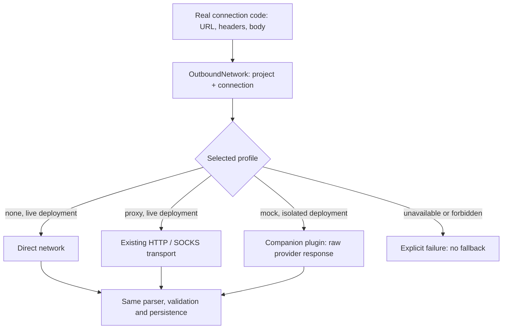

# Network profiles and simulated upstreams

Network profiles reuse `nrProxyProfiles` and its encrypted `NOREACH_PROXY_PROFILES` setting. Existing IDs, URLs, credentials, revision checks, administrator authorization and reference-protected deletion remain compatible. `kind` omitted means the existing real proxy; `kind: mock` selects the companion plugin's in-process upstream. No TLS interception, fake proxy URL, global `fetch` replacement or live fallback is involved.

## Use

In a **dedicated demo/test deployment**, enable `nocoreachMock` under the existing [database, storage, worker and side-effect isolation rules](MOCK-DATA.md#2-必须隔离的部署配置). The deployment flag permits the mock executor and prohibits live upstreams; it no longer silently overrides the selected network profile.

Open **Settings → Network profiles** (`/proxy-profiles`), create a **Simulated data** profile, and choose a scenario, seed and timezone-bearing fixed time. Defaults are supplied by the form. A mock profile has no upstream proxy credentials. Its type is immutable: create another profile rather than turning a referenced mock into a live proxy.

In **Data connections**, choose that profile in the connection's Network section and save. **Apply to all data connections** atomically assigns the same mock profile to every connection group in the current project. A shared profile's edits affect all its references on their next operation; its reference list makes that scope visible. GA4/GSC share `google`; GitHub repository/traffic/discussions share `github`; the DataForSEO-powered features share `dataforseo`. Bilibili and Xiaohongshu now have their own mock selections.

No selection means **direct** in a live deployment and **paused** in a mock deployment. Missing selections, broken settings, unsupported operations and missing mock executors fail explicitly. In a mock deployment a saved real proxy cannot be used for upstream collection. Pausing keeps saved data and a read-only clock provenance so historical reports do not jump to the wall clock. It does not cancel in-flight work; use the source's cancellation controls.

The mock **Test connection** result validates the saved configuration and executor availability only. It explicitly does **not** assert rule coverage for every endpoint or claim that the real target is reachable. Real proxy tests retain their existing HEAD request and status reporting.

## Request flow



Only mock operations freeze the selection map. Real requests retain per-request proxy resolution, error timing, DNS/public-address checks, pinned IP/SNI, redirect limits, body bounds, cancellation, authentication and pool retirement. Public simulated downloads select their mock before DNS. The application does not weaken the live public-address policy for `.example` targets.

Media adapters retain their existing external-dependency boundaries and real schemas. Bilibili/Xiaohongshu consume synthetic collector protocol responses; YouTube consumes synthetic runner/caption output. Their contexts now come from the respective network profile. They do not run a browser, OpenCLI or yt-dlp. Real browser-bridge traffic remains deployment-owned and unproxied; selecting a live proxy for these bridge connections is rejected. This is not browser/extractor or anti-bot certification.

A mock operation freezes the profile ID, revision, scenario, seed, clock, project and connection. Editing or clearing a selection changes subsequent operations, not an existing one. Google background jobs persist a credential-free snapshot and restore it with the existing project/job checks. Pre-upgrade queue snapshots remain readable. DataForSEO's mock cache key includes profile identity and revision so a scenario change does not silently reuse a different simulated query; the real query-hash format is unchanged. Other saved histories and source-specific retention rules are not erased by a profile edit.

## Upgrade and compatibility

After the permanent dataset guard, an idempotent conversion creates a mock profile for each legacy enabled project's scenario/seed/clock and explicitly selects it for its connection groups. Legacy disabled projects remain paused, including when an old real proxy selection had existed behind the global mock override. Existing real profiles and encrypted credentials remain stored. Migration never drops projects to satisfy the interactive 50-profile creation cap.

The automatic demo initializer explicitly creates/selects its own profile before running normal connection and sync code. It preserves completed phases and deliberate changes. `nocoreachMock.initializeData: false` still gives an empty isolated test installation; it does not delete existing data. Initializing demo business records remains an application-owned operation, not an effect of selecting a network profile.

The old `/mock-integrations` URL redirects to `/proxy-profiles`; the duplicate application mock-settings menu is removed. `nrMock/status` remains readable under existing permissions as a compatibility indicator/business-clock view, **not** a per-connection routing decision. Its project-wide view uses the first selected mock connection in the existing connection order. For coherent cross-source historical reports, use a shared seed/clock across profiles; different scenarios may still be selected independently.

Application calls to `nrMock/configure` and `nrMock/reset` now return `409 NR_MOCK_USE_NETWORK_PROFILES`, rather than silently changing an unused second routing configuration. The independently reusable plugin retains its legacy API when no host `projectSettings` view is installed. Internal consumers must use profiles in the NocoReach host.

Real Agent configuration, model testing, Runner execution and native permissions remain independent and unchanged. Existing simulated business-AI/release behavior and external mail/notification guards remain in place. This refactor is not a general network sandbox for arbitrary plugins or subprocesses and does not expand the fixture catalog beyond its documented operations.

## API examples

All actions use the normal `/api/nocoreach/` prefix and existing authentication. `nrProxyProfiles` actions are administrator-only; project-scoped actions additionally validate project access. Example UUIDs and project IDs must be replaced with returned values.

```json
// nrProxyProfiles/save — create
{
  "kind": "mock",
  "name": "Demo data",
  "mock": {
    "scenario": "normal",
    "seed": "demo",
    "clock": "2026-10-13T00:00:00.000Z"
  }
}
```

To edit, add the returned `id` and current `revision`; stale revisions return 409. Do not submit `projectId`, proxy URL, username, password or read-only response fields to mock profile `save`. `select` takes `{projectId, connection, profileId}`; `selectAll` takes `{projectId, profileId}`. A null `profileId` clears the selection. `capabilities` reports deployment-owned mock availability and scenario names. `test` takes `{id}`; `testConnection` takes `{projectId, connection}`.

## Verification

`tests/nocoreach/network-profiles.test.ts` covers schemas, secret preservation, migration, fail-closed dispatch, actual raw fixture responses, profile snapshots, cache identity and configuration-only validation. Existing real proxy tests cover authenticated TLS tunneling, DNS failures, redirects, limits, pool lifecycle and cancellation. Application tests exercise real authentication, parsers, SQLite persistence, every supported connection, historical reports and demo initialization with external I/O forbidden. Component tests cover creation, selection, bulk assignment and distinct simulated validation feedback.

Run the relevant groups with `pnpm exec vitest run <files> --maxWorkers=1` and the application TypeScript checks. Browser verification, CI and independent review results belong in the PR; test commands here do not claim execution or prove an absence of all regressions.
